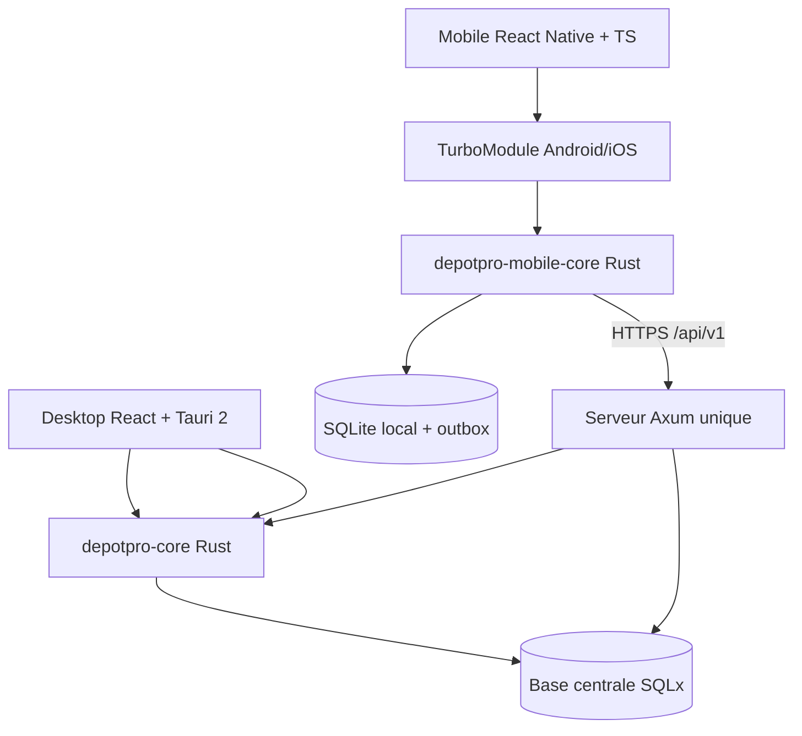
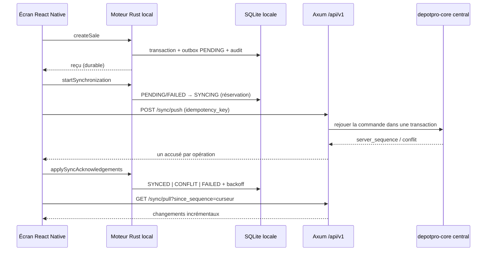
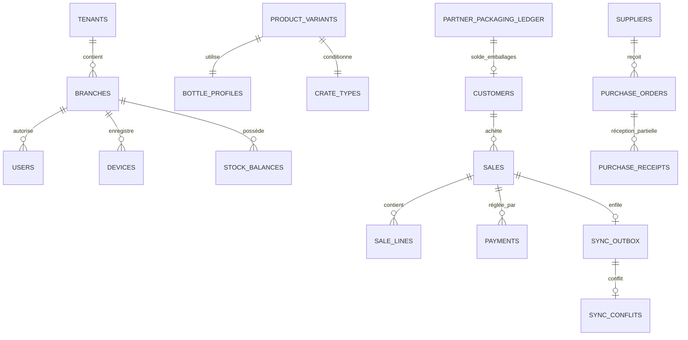

# Diagrammes, règles métier et parité plateformes

## 1. Architecture logique

## 2. Flux de synchronisation

## 3. Modèle de données (entités fonctionnelles)

Les noms réels de la base locale sont documentés dans `rust/src/db.rs` ; le serveur central conserve ses propres migrations `0001`–`0005`.

## 4. Règles métier centralisées

| Domaine | Règle | Responsable |
| --- | --- | --- |
| Montants | FCFA entier `i64`, aucun flottant, `checked_*` sur toutes les opérations | Rust (`domain.rs`) |
| Bottilles | Quantités physiques entières ; demi-casier calculé depuis la capacité configurée | Rust (`physical_units`) |
| Casiers mixtes | Capacité exacte, même groupe physique, jetable interdit | Rust (`validate_mixed_case`) |
| Crédit | `outstanding + credit <= credit_limit`, client requis | Rust + `depotpro-core` |
| Paiements | Mobile Money non confirmé = en attente, jamais encaissé | Rust (`validate_sale`) |
| Emballages | Registre immuable ; correction par écriture inverse | Rust + parent |
| Synchronisation | Idempotence par clé, un accusé par opération, conflits visibles | Adaptateur Axum + Rust |

## 5. Parité des fonctionnalités

| Fonction | Android (RN) | iOS (RN) | Desktop (Tauri) | Serveur Axum |
| --- | --- | --- | --- | --- |
| Vente simple / mixte / crédit | Oui (moteur Rust local) | Oui (même moteur) | Oui (`depotpro-core`) | Rejouée via `SyncKernel` |
| Caisse, achats, réceptions | Oui | Oui | Oui | Rejouées via `SyncKernel` |
| Comptes clients/fournisseurs | Oui, séparés | Oui, séparés | Oui | Cohérence centrale |
| Catalogue et consignes | Oui | Oui | Oui | Distribution via pull |
| Synchronisation multi-appareils | Contrat câblé | Contrat câblé | Via serveur | Routes à intégrer dans le parent |
| Confirmation Mobile Money opérateur | À brancher | À brancher | Selon parent | À brancher |
| Reçu PDF / partage / impression | À brancher | À brancher | Oui (`pdf` core) | Stockage central |
